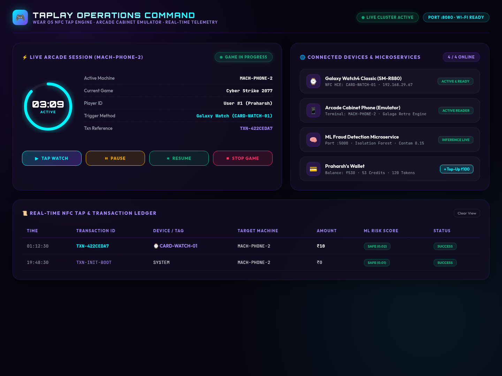
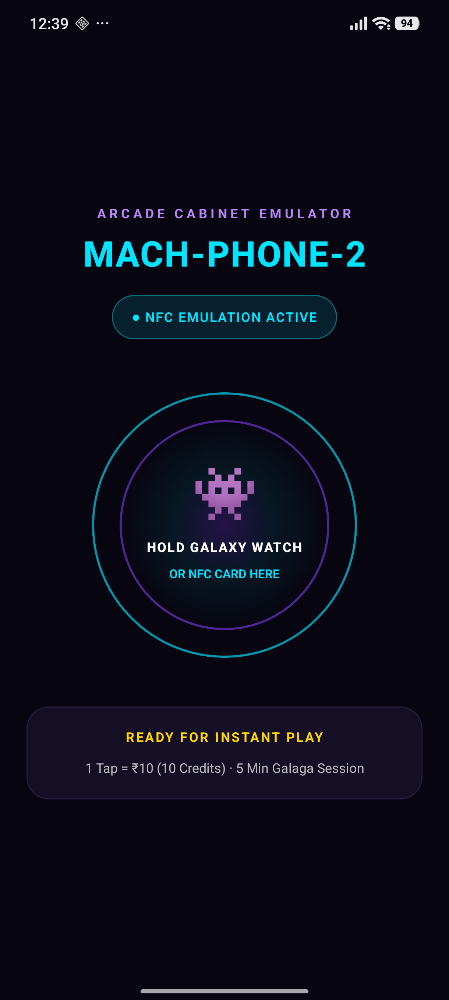
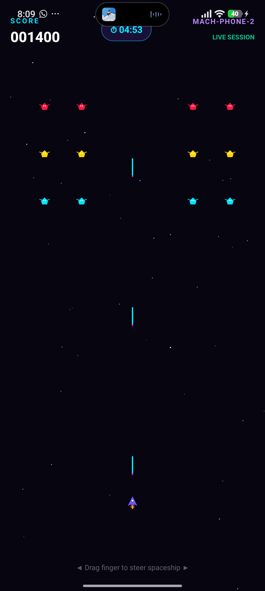
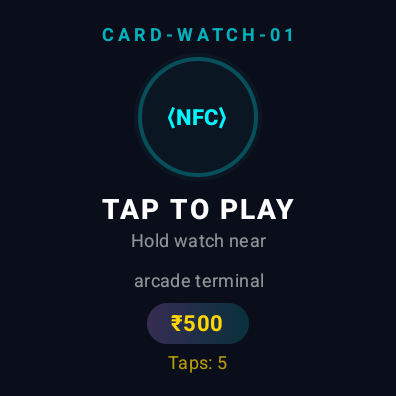
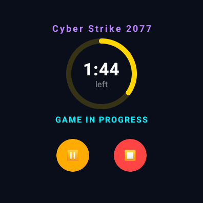
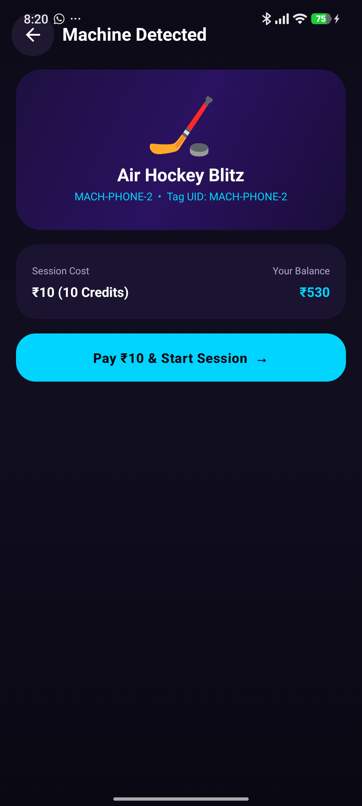

# 🎮 TAPLAY: Multi-Device UI Showcase & Visual Design System

> **Document Classification:** User Interface & Experience (UI/UX) Visual Master Guide  
> **Ecosystem:** Android Mobile App · Wear OS Galaxy Watch · Playable Arcade Cabinet Emulator · Web Operations Dashboard  
> **Visual Aesthetic:** Cyber-Arcade Dark Mode (Deep Navy `#070510`, Neon Cyan `#00F5FF`, Violet Glow `#7C3AED`, Emerald `#10B981`, Rose `#FF3366`)  
> **Output Artifact Path:** `/home/pracxy/Taplay/UI.md`  

---

## 📋 Table of Contents
1. [Visual System Architecture & Design Tokens](#1-visual-system-architecture--design-tokens)
2. [Web Operations & Telemetry Dashboard](#2-web-operations--telemetry-dashboard)
3. [Phone Arcade Cabinet Terminal & Playable Galaga Game](#3-phone-arcade-cabinet-terminal--playable-galaga-game)
4. [Wear OS Galaxy Watch Smartwatch Interface](#4-wear-os-galaxy-watch-smartwatch-interface)
5. [Consumer Mobile Patron Application](#5-consumer-mobile-patron-application)
6. [Multi-Device Real-Time Synchronization in Action](#6-multi-device-real-time-synchronization-in-action)

---

## 1. Visual System Architecture & Design Tokens

Taplay implements a unified cyber-arcade design language across all screens, from smartwatch viewports (396×396 px) up to 4K desktop browser displays.

```
+───────────────────────────────────────────────────────────────────────────────────────────────+
|                                  TAPLAY COLOR PALETTE & TOKENS                                |
+───────────────────────────────────────────────────────────────────────────────────────────────+
| Token Name          | Hex Code   | Usage                                                      |
| :------------------ | :--------- | :--------------------------------------------------------- |
| Background Deep     | #070510    | Ultra-dark space background (OLED energy efficiency)       |
| Background Card     | #0D0A18    | Glassmorphic card surface with 82% opacity                 |
| Border Glass        | #7C3AED38  | 1px translucent violet perimeter glow                     |
| Neon Cyan           | #00F5FF    | Primary active state, NFC beacon, active lasers, timer arc  |
| Electric Violet     | #7C3AED    | Primary brand accent, button gradients, level progression |
| Laser Emerald       | #10B981    | Authorized transaction badges, wallet balance credits      |
| Cyber Rose          | #FF3366    | Critical session alerts (<30s), alien collisions, fraud log |
| Amber Glow          | #FFB300    | Session paused state, high-velocity warning flag           |
+───────────────────────────────────────────────────────────────────────────────────────────────+
```

---

## 2. Web Operations & Telemetry Dashboard

The **Web Operations Dashboard** (`http://localhost:8080/`) serves as the central command console for arcade floor supervisors, amusement center engineers, and floor managers. It connects to the Spring Boot backend via high-speed polling, updating live SVG meters, system health, and transactional ledgers.

### 🖼️ Live Web Operations Dashboard Screenshot


### Key Dashboard Modules:
1. **System Health & Connectivity Badges**:
   - `H2 Embedded DB`: Shows active Hikari connection pool status.
   - `Python ML Fraud Engine (:5000)`: Real-time health pulse of the Isolation Forest model.
   - `NFC Terminal (:8080)`: Shows active machine connection state (`MACH-PHONE-2`).
2. **Cabinet Telemetry Dial (Center Component)**:
   - Dynamic SVG circular countdown meter that depletes as gameplay elapses.
   - Live machine badge: `MACH-PHONE-2 · Cyber Strike 2077`.
   - Player card: `Praharsh (CARD-WATCH-01)`.
   - Remaining time display (`MM:SS`) with color shift: Neon Cyan (Normal) ➔ Amber (Paused) ➔ Cyber Rose (< 30s remaining).
3. **Supervisor Remote Overrides**:
   - **[⏸ PAUSE SESSION]**: Transmits a pause trigger to freeze the countdown and freeze the physical/virtual cabinet.
   - **[▶ RESUME SESSION]**: Re-engages the session and unfreezes the arcade game.
   - **[⏹ EMERGENCY STOP]**: Remotely terminates the game session, freeing the machine for the next player.
4. **Live Transaction Audit Ledger**:
   - Real-time ledger recording every NFC tap, balance debit, top-up, and fraud assessment.
   - Displays transaction ID (`TXN-422CEDA7`), machine ID, amount, timestamp, and status badges (`SUCCESS`, `FLAGGED_FRAUD`).

---

## 3. Phone Arcade Cabinet Terminal & Playable Galaga Game

When an Android phone runs the debug build (`com.taplay.app.emulator`), it transforms into an autonomous **Arcade Cabinet Terminal** (`MACH-PHONE-2`). It continuously listens for incoming NFC card or smartwatch taps in foreground reader mode.

Upon detecting an authorized tap, the terminal emits a classic arcade coin chime and boots directly into an authentic, custom-built retro **Galaga Space Shooter** rendered at 60 FPS on Jetpack Compose Canvas!

### 🖼️ Arcade Cabinet: Idle Ready State vs. Active Galaga Gameplay

| Cabinet Screen: Idle State (Waiting for Tap) | Cabinet Screen: Active 60-FPS Galaga Game |
| :---: | :---: |
|  |  |
| *Displays `MACH-PHONE-2 · HOLD GALAXY WATCH OR NFC CARD HERE` with radar scanline animations.* | *Full 60-FPS retro arcade game: drag steering, auto dual lasers, starfield parallax, and alien formations.* |

### Galaga Arcade Engine Highlights:
- **Canvas Particle Engine**: Destroying an alien triggers radial velocity particle explosions with color decay.
- **Sinusoidal Alien Flight Paths**: Invader formations oscillate horizontally and dive-bomb based on mathematical trigonometric curves (`sin(angle)`).
- **Parallax Starfield**: Multi-layered background stars traveling at variable velocities to simulate 3D space depth.
- **Wrist-Driven Pause Synchronization**: If the player taps **Pause** on their Galaxy Watch, the Galaga engine instantly freezes game physics and renders a semi-transparent violet overlay: **"SESSION PAUSED FROM WRIST"**.

---

## 4. Wear OS Galaxy Watch Smartwatch Interface

The **Taplay Wear** app (`com.taplay.wear`) runs on Samsung Galaxy Watch4 (and any Wear OS 4+ smartwatch). It acts as both a **Virtual Smartcard (HCE)** and a **Live Session Companion**.

### 🖼️ Galaxy Watch: Ready Mode vs. Active Live Session

| Watch Screen: Ready State (HCE Active) | Watch Screen: Active Live Session Countdown |
| :---: | :---: |
|  |  |
| *Emulates `CARD-WATCH-01`. Glowing neon cyan pulse ring, `TAP TO PLAY`, and live wallet balance (`₹500`).* | *Live circular countdown timer ring (`04:58`), game title (`Cyber Strike 2077`), and `[⏸ Pause]` & `[⏹ Stop]` buttons.* |

### Watch UI Features:
1. **Idle Beacon**: Radiates a soft neon pulse inviting the player to tap their wrist against the arcade cabinet.
2. **Wi-Fi Balance Sync**: Displays player credits fetched directly over Wi-Fi without needing a companion phone nearby.
3. **Wrist Remote Control**:
   - **`[⏸ Pause]`**: Sends an HTTP request to pause the game session on the cabinet.
   - **`[▶ Resume]`**: Resumes play and recalculates elapsed time with mathematical pause-offset compensation.
   - **`[⏹ Stop]`**: Ends the session early, frees the cabinet, and logs completion.

---

## 5. Consumer Mobile Patron Application

When running in consumer mode (`com.taplay.app`), the phone functions as the patron's personal arcade companion, digital wallet, and tag scanner.

### 🖼️ Consumer Tag Detection Radar

*Pulsating radar waves confirm physical NFC tag contact with machine identifier and credit cost.*
*Pulsating radar waves confirm physical NFC tag contact with machine identifier and credit cost.*

### Consumer App Features:
1. **Home Screen (`HomeScreen.kt`)**: Displays real-time INR balance (`₹540`) and arcade tokens (`54`), a radial "Tap to Play" quick button, game catalog carousel, and navigation items.
2. **Active Session Screen (`SessionActiveScreen.kt`)**: Circular progress ring tracking playtime with visual warning pulses when under 30 seconds.
3. **Transaction & Top-Up Hub (`TransactionScreen.kt`)**: Complete Razorpay test flow simulation supporting preset amounts (₹50, ₹100, ₹200, ₹500), UPI, debit/credit cards, and digital receipts.
4. **Avatar Customizer (`AvatarScreen.kt`)**: Cybernetic character progression unlocking perks and profile avatars (Blaze, Frost, Volt, Shadow).

---

## 6. Multi-Device Real-Time Synchronization in Action

The hallmark of the Taplay architecture is how all devices synchronize their visual states simultaneously:

```
  STEP 1: PATRON TAPS WRIST AGAINST CABINET TERMINAL
  ┌────────────────────────────────────────────────────────┐
  │ • Galaxy Watch touches Phone Cabinet (13.56 MHz NFC)   │
  │ • Watch broadcasts: "CARD-WATCH-01" via HCE APDU       │
  │ • Phone Cabinet reads ID and calls Backend API         │
  └───────────────────────────┬────────────────────────────┘
                              │
                              ▼
  STEP 2: SIMULTANEOUS MULTI-SCREEN TRANSITION
  ┌────────────────────────────────────────────────────────────────────────┐
  │ 1. Phone Cabinet  ➔ Launches retro 60FPS Galaga Arcade Game!           │
  │ 2. Galaxy Watch   ➔ Switches to Active Session ring with [Pause/Stop]  │
  │ 3. Web Dashboard  ➔ Animates radial countdown dial & logs transaction   │
  └───────────────────────────┬────────────────────────────────────────────┘
                              │
                              ▼
  STEP 3: REMOTE CONTROL FROM WRIST
  ┌────────────────────────────────────────────────────────────────────────┐
  │ • Patron taps [⏸ Pause] on Galaxy Watch                                │
  │ • Phone Cabinet immediately freezes Galaga lasers, aliens, and stars   │
  │ • Web Dashboard displays amber "PAUSED" indicator                      │
  │ • Patron taps [▶ Resume] ➔ Everything unfreezes smoothly!              │
  └────────────────────────────────────────────────────────────────────────┘
```

---
*Created for the Taplay Arcade Platform Visual Documentation.*
